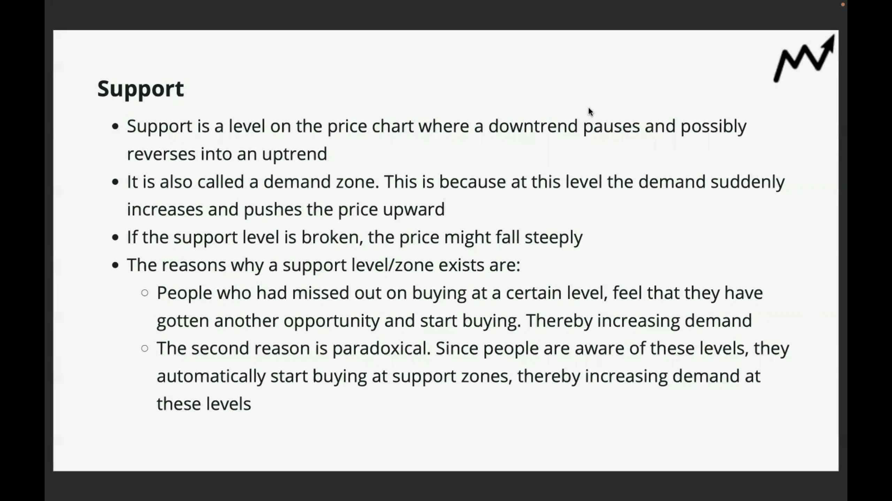

# 4: Supply and Demand

Why Uptrend and downtrend happen?

it’s due to big money accumulating stocks or selling stocks, they have large quantity to account for stock liquidity

In uptrend they can’t buy everything at once, they will do stage buying

In downtrend they can’t sell everything at once, they will do stage selling

         

