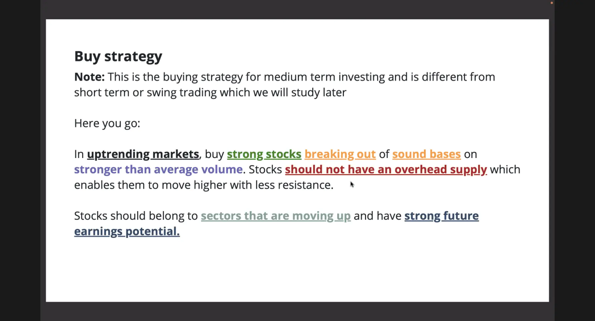

# 5,6,7: Buy Strategy

do Stage analysis  on weekly chart

for short term trend use 10,20 moving day averages

Length of correction in stage 2 is signs of End of Stage 2

also lenght of stage 2 is also larger then stage 4, because market is upword bias

### Stage 1 Vs Stage 3

- stage 1 happen after bear market
- stage 3 happen after bull market
- in stage 3 we see pattern like  h&s or double or triple top
- In stage 1, we might see pattern like inverted h & s or double or tiple bottom
- the 200 day ema would be above the price in stage 1 and below the price in stage 3

- when long and short term both is up then it’s best time get fully invested

closing price is average of last 30 mins price

## Breakouts

### Overhead supply

### Screeners

put all possible stock on verge of break out  on watchlist

on zerodha you can put stock alert 

when you get alert you can buy stock between 3-3:30

### Trading view premium

initial stoploss aroudn 12%, trailing stop loss should be around 8%

Ans : 4-6 Stocks are too risky, only do this if you’re really experience. you need to keep atleast 10 Stocks in your portfolio, even I keep 10 stocks

## Chart Patterns

### VCP pattern

- It’s one of the best break out pattern

### Cup with handle

Time period is also important with cup with handle or any pattern, few weeks normally

chart pattern are here to give us idea about what’s happening behind the scene

### Double Bottom

### Flat Base

bull flag

## IPO Base

Ipo base normally take 6-8 weeks to form

## ReTest of previous high

## Volume

- use 50 day moving average on volume

## Sector Analysis

## Buy Strategy

### Relative Strenght

- We don’t buy stock with good fundamentals
- when we have 2 stock with good technicals but we need to choose only one, then we choose one with better fundamental, so it has higer potential of going up
-